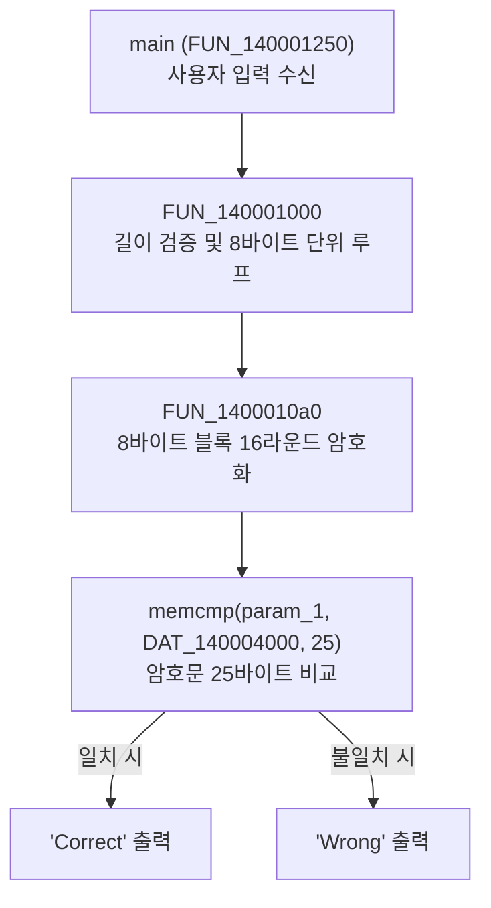

**[Notice]**본 포스팅은 리버스 엔지니어링 학습용 디컴파일 코드 분석 노트입니다. 드림핵 가이드라인에 맞춰 전체 정답 FLAG 값 및 완성형 자동 스크립트는 포함하지 않으며, 암호화 알고리즘의 원리 분석과 역산 수식 유도, 그리고 파이썬을 활용한 헤더 검증 방식을 중심으로 정돈했습니다.

# [Dreamhack] rev-basic-9 풀이 및 7시간 분석기 (상세 Write-Up)

<div style="text-align: center; margin: 20px 0;">
  
  <p style="font-size: 0.9em; color: #666;">[손 노트]</p>
</div>

---

## 1. 들어가며

드림핵의 `rev-basic` 시리즈 중에서도 `rev-basic-9`는 앞선 기초 문제들과 결이 완전히 다른 **본격적인 블록 암호(Block Cipher) 구조**를 띠고 있는 문제입니다.

단순 1바이트 단위 연산이 아니라, **8바이트 블록 단위로 16라운드에 걸쳐 S-box 치환, 비트 로테이션, 덧셈/XOR이 얽혀 있는 구조**입니다.

이 문제를 풀면서 Ghidra로 디컴파일된 C 코드를 한 줄씩 뜯어보며 의미를 파악하고, 비트 연산의 본질을 분석하여 역산 스크립트(`decode.py`)를 완성하기까지 **7시간 동안 치열하게 고민하고 공부했던 과정**을 블로그에 정리합니다.

---

## 2. 전체 프로그램 흐름 분석

바이너리를 디컴파일하여 `main` 함수부터 순서대로 함수 호출 흐름을 파악했습니다.



---

## 3. 세부 코드 분석

### 3.1. `main` 함수 분석 (`main.c` / `FUN_140001250`)

```c
/* WARNING: Function: __security_check_cookie replaced with injection: security_check_cookie */

undefined8 FUN_140001250(undefined8 param_1, undefined8 param_2, undefined8 param_3, undefined8 param_4)
{
  undefined8 uVar1;
  longlong i;           // lVar2 == i
  char *v3;             // pCVar3 == v3
  undefined1 c [32];
  char s [256];
  ulonglong s2;
  
  s2 = DAT_140004128 ^ (ulonglong)c;  // 스택 카나리(Stack Cookie) 설정
  v3 = s;
  for (i = 256; i != 0; i = i + -1) {
    *v3 = '\0';         // 입력 버퍼 s를 0(NULL)으로 초기화
    v3 = v3 + 1;
  }
  FUN_1400012e0("Input : ", param_2, param_3, param_4); // printf("Input : ")
  FUN_140001340("%256s", s, param_3, param_4);          // scanf_s("%256s", s)
  uVar1 = FUN_140001000(s);                             // 문자열 검증 함수 호출
  if ((int)uVar1 == 0) {
    puts("Wrong");
  }
  else {
    puts("Correct");
  }
  return 0;
}
```

#### 분석 요약
- 사용자로부터 최대 256자의 문자열 `s`를 입력받습니다.
- `FUN_140001000(s)`를 호출하여 그 반환값이 `1`이면 `"Correct"`, `0`이면 `"Wrong"`을 출력합니다.
- 따라서 핵심 로직은 **`FUN_140001000`**과 그 내부 서브루틴에 있습니다.

---

### 3.2. 검증 제어 함수 분석 (`Fun14000.c` / `FUN_140001000`)

```c

undefined8 FUN_140001000(char *param_1)

{
  int iVar1;
  size_t sVar2;
  undefined8 uVar3;
  uint uVar4;
  int i; //local_18 =i
  
  sVar2 = strlen(param_1); //인자의 길이를 구하고
  iVar1 = (int)sVar2 + 1; // 인자의 길이에 1칸 추가
  uVar4 = iVar1 >> 0x1f & 7; // >> 연산 우선 후 & : 오른쪽으로 31칸 이동 후 하위 3비트 추출(8로 나눈 나머지 추출)
  if ((iVar1 + uVar4 & 7) == uVar4) { // 8로 나눈 나머지와 같다면
    for (i = 0; i < (int)sVar2 + 1; i = i + 8) {
      // 8글자씩 암호화 함수에 집어넣음 
      FUN_1400010a0((byte *)(param_1 + i));
    }
    iVar1 = memcmp(param_1,&DAT_140004000,25); //param_1과 DAT_140004000을 25바이트까지 비교해서 완전 같아야함.
    // DAT == 7e 7d 9a 8b 25 2d d5 3d 03 2b 38 98 27 9f 4f bc 2a 79 00 7d c4 2a 4f 58 
    // 위 연산에서 param_1이 DAT값과 똑같이 나와야 함
    // 즉 param_1의 값이 FUN_1400010a0에서 어떻게 바뀌는지를 알 수 있음
    //param_1은 널바이트 제외하고 24바이트 크기임을 알 수 있음
    if (iVar1 == 0) { //iVar1 == 0이어야 uVar3가 1임. 
      uVar3 = 1;
    }
    else {
      uVar3 = 0;
    }
  }
  else {
    uVar3 = 0;
  }
  return uVar3;
}

```

####  분석 요약
1. **문자열 길이 조건**: 
   - `(iVar1 + uVar4 & 7) == uVar4`는 컴파일러가 `(strlen + 1) % 8 == 0`을 비트 연산으로 최적화한 형태입니다.
   - 뒤에서 `memcmp`로 **25바이트**를 비교하고 있으므로, 널 바이트를 포함한 길이는 **24바이트 + 널 바이트 1개 = 25바이트**입니다.
   - 즉, 플래그의 순수 길이는 **24글자**이며, 8바이트씩 총 **3개 블록**(`i = 0, 8, 16`)으로 처리됩니다.
2. **비교 대상 암호문 (`DAT_140004000`)**:
   ```text
   7e 7d 9a 8b 25 2d d5 3d 03 2b 38 98 27 9f 4f bc 2a 79 00 7d c4 2a 4f 58
   ```

---

### 3.3. 핵심 암호화 함수 분석 (`Fun10a0.c` / `FUN_1400010a0`)

이 문제에서 가장 깊게 파고들어야 했던 16라운드 암호화 함수입니다.

```c

/* WARNING: Function: __security_check_cookie replaced with injection: security_check_cookie */

void FUN_1400010a0(byte *param_1)

{
  longlong i;
  byte *v2;
  byte *v3;
  byte result;
  int k;
  int j;
  byte a3 [40];
  
  v2 = &DAT_140003230; // v2 == 49 5f  61  6d ds 5f  4b  45  59

  v3 = a3;
  for (i = 9; i != 0; i = i + -1) {
    *v3 = *v2;
    v2 = v2 + 1;
    v3 = v3 + 1;
  }
  //data = "63 7c 77 7b f2 6b 6f c5 30 01 67 2b fe d7 ab 76 ca 82 c9 7d fa 59 47 f0 ad d4 a2 af 9c a4 72 c0 b7 fd 93 26 36 3f f7 cc 34 a5 e5 f1 71 d8 31 15 04 c7 23 c3 18 96 05 9a 07 12 80 e2 eb 27 b2 75 09 83 2c 1a 1b 6e 5a a0 52 3b d6 b3 29 e3 2f 84 53 d1 00 ed 20 fc b1 5b 6a cb be 39 4a 4c 58 cf d0 ef aa fb 43 4d 33 85 45 f9 02 7f 50 3c 9f a8 51 a3 40 8f 92 9d 38 f5 bc b6 da 21 10 ff f3 d2 cd 0c 13 ec 5f 97 44 17 c4 a7 7e 3d 64 5d 19 73 60 81 4f dc 22 2a 90 88 46 ee b8 14 de 5e 0b db e0 32 3a 0a 49 06 24 5c c2 d3 ac 62 91 95 e4 79 e7 c8 37 6d 8d d5 4e a9 6c 56 f4 ea 65 7a ae 08 ba 78 25 2e 1c a6 b4 c6 e8 dd 74 1f 4b bd 8b 8a 70 3e b5 66 48 03 f6 0e 61 35 57 b9 86 c1 1d 9e e1 f8 98 11 69 d9 8e 94 9b 1e 87 e9 ce 55 28 df 8c a1 89 0d bf e6 42 68 41 99 2d 0f b0 54 bb 16 cd"
  result = *param_1;
  for (j = 0; j < 0x10; j = j + 1) {
    for (k = 0; k < 8; k = k + 1) {
      result = (byte)((&data)[(int)(uint)(result ^ a3[k])] + param_1[(int)(k + 1U & 7)]) >> 5 |
                 ((&data)[(int)(uint)(result ^ a3[k])] + param_1[(int)(k + 1U & 7)]) * '\b'; // \b == ACI(8) 즉 * 8은 왼쪽 시프트 3번!
      param_1[(int)(k + 1U & 7)] = result;
    }
    // result = (data[result ^ a3[k]] + param_1[k+1U & 7]) >> 5 | (data[result ^ a3[k]] + param_1[k+1U & 7] << 3)
    // max_val = data[result ^ a3[k]] + param_1[k+1U & 7]
    // min_val = data[result^ a3[k]] + param_1[k+1U & 7]
    // result = max_val >> 5 | min_val << 3 ==> 비트 로테이션임 
    /*
    ex) 원본 A B C D E F G H
    >> 5 : 0 0 0 0 0 A B C
    << 3 : D E F G H 0 0 0
    결과 : D E F G H A B C 이렇게 손실 없이 로테이션됨 

    역연산시 뱡향만 바꿔서 로테이션 해주면 됨
    */
    // S = data[result ^ a3[k]]
    // P = param_1[R+1U &7]
    // result == C
    // C= (S+P) >> 5 | (S + P) << 3 ;
    // P(원본 문자열)을 구하는 식으로 변경

    
  }
  return;
}


```

---

## 4. 7시간 동안의 삽질과 역연산 수학 유도 과정 

이 함수를 파이썬 역산 코드로 변환할 때 머리를 싸매게 만든 핵심 포인트들을 정리합니다.

### 4.1. `* '\b'`의 정체 파악 (비트 로테이션)
디컴파일 코드에서 `* '\b'`라는 표현이 등장합니다.
- `'\b'`는 ASCII 코드 `8` (백스페이스)입니다.
- 즉, 어떤 값에 `8`을 곱한다는 것은 **왼쪽으로 3비트 시프트(`<< 3`)**하는 것과 같습니다!
- 따라서 수식은 다음과 같이 정리됩니다:

```text
val = data[result ^ a3[k]] + param_1[(k + 1) & 7]
result = (val >> 5) | (val << 3)
```

이것이 바로 1바이트(8비트) 내에서의 **비트 로테이션(Bit Rotation / ROR 5 또는 ROL 3)**입니다!

```text
예시: 1바이트 [A B C D E F G H]
>> 5 : [0 0 0 0 0 A B C]
<< 3 : [D E F G H 0 0 0]
OR결과: [D E F G H A B C]  --> 비트 손실 없이 순환 회전됨!
```

>  **비트 로테이션의 역연산:**
> 오른쪽으로 5칸(왼쪽으로 3칸) 돌렸으므로, 역연산할 때는 반대로 **왼쪽으로 5칸, 오른쪽으로 3칸** 돌려주면 완벽히 원래 값으로 복원됩니다!
>
> $$\text{Rotated\_Left}(C) = ((S+P \ll 5) \mid (S+P \gg 3)) \ \& \ \text{0xFF}$$

---

### 4.2. 변수들의 관계식 및 원본($P$) 유도

각 변수를 단순화해 보면 다음과 같습니다:
- $S = \text{data}[result \oplus \text{key}[k]]$ (S-box 치환 값)
- $P = param\_1[(k + 1) \ \& \ 7]$ (암호화 대상 원본 바이트)
- $C = result$ (암호화 완료된 바이트)

정방향 암호화 수식:
$$C = \text{Rotate\_Right}((S + P) \ \& \ \text{0xFF}, 5)$$

양변을 왼쪽으로 5비트 역회전:
$$\text{Rotate\_Left}(C, 5) = (S + P) \ \& \ \text{0xFF}$$

따라서 구하고자 하는 원본 $P$는:
$$P = (\text{Rotate\_Left}(C, 5) - S) \ \& \ \text{0xFF}$$

---

### 4.3. 블록 오프셋 + i의 비밀과 사물함 비유 (핵심!)

역연산 루프를 짤 때 무심코 넘어가기 쉽지만, 빼먹으면 복구가 완전히 망가지는 가장 중요한 포인트가 바로 **+ i**입니다.

```py
# C = encrypt_byte[i + next_idx]  <-- 여기서 '+ i'를 왜 해줄까?
# prev_result = encrypt_byte[i + k]

```

#### "방 내부 번호"와 "전체 사물함 번호"의 차이
전체 암호문 24바이트는 8바이트씩 3개의 구역으로 나뉩니다:
- 1구역: 0 ~ 7번 사물함 (i = 0)
- 2구역: 8 ~ 15번 사물함 (i = 8)
- 3구역: 16 ~ 23번 사물함 (i = 16)

루프 안의 k와 next_idx = (k + 1) & 7은 8바이트 크기의 방 안에서만 움직이는 **'방 내부의 방 번호(0~7)'**입니다.

#### 만약 + i를 해주지 않으면?
바깥쪽에서 for i in [0, 8, 16]으로 3번을 돌아도, 안에서는 항상 encrypt_byte[next_idx](즉, 0~7번 위치)만 접근하게 됩니다.
결국 1구역(0~7번) 사물함만 연속으로 3번 덮어쓰며 연산이 이루어지고, 2구역과 3구역은 아예 건드리지도 못해 복호화가 완전히 실패합니다!

따라서 전체 주소의 기준점(Base Address)인 i (0, 8, 16)를 반드시 더해주어야만 컴퓨터가 1구역, 2구역, 3구역 사물함을 정확하게 찾아가서 원래 글자를 복원할 수 있습니다.

---


### 4.4. 역순 루프 설계의 함정 (State 추적)

정방향에서는:
- 라운드: `j = 0`부터 `15`까지 순방향
- 내부 루프: `k = 0`부터 `7`까지 순방향
- `param_1[(k + 1) & 7]`를 갱신하며 이것이 다음 단계의 `result`가 됨

따라서 역방향으로 풀 때는 **모든 루프를 완벽한 역순**으로 돌려야 합니다:
- **블록 루프**: `i in [0, 8, 16]`
- **라운드 루프**: `j = 15`부터 `0`까지 (`range(15, -1, -1)`)
- **바이트 루프**: `k = 7`부터 `0`까지 (`range(7, -1, -1)`)

여기서 중요한 점은 **"직전 단계의 result"**입니다:
- 정방향에서 $k$번째 연산에 쓰이는 `result`는 바로 직전인 $k-1$번째 연산의 결과물, 즉 `param_1[k]`에 들어있던 값입니다!
- 따라서 `prev_result = encrypt_byte[i + k]`로 가져오면 정확히 맞아떨어집니다.

---

## 5. 최종 해결 스크립트 (`decode.py`)

위 분석을 토대로 작성한 완성된 역산 스크립트입니다.
드림핵 가이드라인에 맞게 핵심 의사코드만 표시해두었습니다!

```python

# 8바이트씩 3개 블록 역연산 (총 24바이트)
for i in [0, 8, 16]:
    # 16라운드를 역순으로 (15 -> 0)
    for j in range(15, -1, -1):
        # 8바이트를 역순으로 (7 -> 0)
        for k in range(7, -1, -1):
            next_idx = (k + 1) & 7
            C = encrypt_byte[i + next_idx] # 암호화된 결과값 C
            #param_1 == excrypt_byte
            # + i 를 해주지 않으면 24개를 8로 나눈 3구역 중 1구역에서만 암호화가 이루어짐
            
            prev_result = encrypt_byte[i + k] # 직전 단계의 연산 결과 (result)

            # 비트 로테이션 역연산: 오른쪽 5비트 시프트의 역은 왼쪽 5비트 시프트
            rotated_left = ((C << 5) | (C >> 3)) & 0xFF

            # S-box 치환 값 S 복원
            S = data_byte[prev_result ^ key[k]]

            # 덧셈의 역연산: 뺄셈 후 1바이트 마스킹
            P = (rotated_left - S) & 0xFF

            # 복원된 원본 바이트로 갱신
            encrypt_byte[i + next_idx] = P


```

---

## 6. 7시간의 여정을 마치며

1. **디컴파일러의 기만(?)을 꿰뚫어 보는 눈**:  
   `* '\b'`를 보고 단순 곱셈이 아니라 `<< 3`으로 즉각 치환하여 생각할 수 있었던 것이 이번 문제 해결의 가장 큰 열쇠였습니다.
2. **비트 로테이션의 가역성(Invertibility)**:  
   단순 시프트는 비트가 버려지지만, 로테이션(`>> 5 | << 3`)은 정보 손실이 없기 때문에 완벽한 역연산이 가능하다는 것을 손으로 비트를 그려보며 확실하게 이해했습니다.
3. **블록 암호의 라운드 구조 체감**:  
   Ghidra에서 3중 루프를 보고 처음엔 아득했지만, 블록 크기(8), 라운드 수(16), 내부 갱신 규칙을 분해하고 역순으로 하나씩 되감아 푸는 쾌감을 제대로 느낄 수 있었습니다.

7시간 동안 머리를 쥐어뜯었지만, 그만큼 비트 연산과 역연산에 대한 자신감을 얻어갈 수 있었던 값진 문제였습니다. 끝! 
